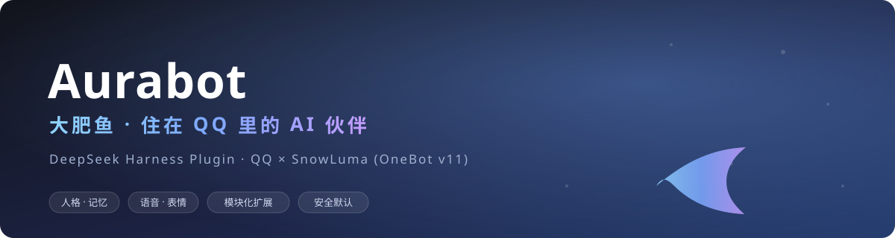

<div align="center">



**住在 QQ 里的 AI 伙伴「大肥鱼」· DeepSeek Harness 插件**

有人格、有心情、有记忆；能聊天、看图、发语音、发表情、唱歌、写空间、刷 B 站，还会主动找你。

[English](README_EN.md) · **简体中文**

[](https://github.com/aureth-labs/dsh-aurabot-qq/releases)
[](LICENSE)
[](https://github.com/deepseek-ai/deepseek-harness)
[](https://github.com/SnowLuma/SnowLuma)
[](https://github.com/aureth-labs/dsh-aurabot-qq/stargazers)
[](#-参与贡献)

</div>

> Aurabot 把 **DeepSeek Harness（DSH）** 里的 AI 变成一个有 QQ 号的「人」：独立人格、会生气会开心、记得住聊天里的细节、认识你的朋友，也能在群里接梗、发语音条、用自己的声音唱歌、给空间写日记、刷 B 站。
>
> 不是又一个「关键词回复机器人」——她的每一次回复、要不要接话、用什么模型、发出去什么，都是可插拔的模块；默认一切都是关着的，**不手动打开，一句话都不会发出去。**

```
QQ ⇄ SnowLuma（OneBot v11，你自己安装/已有机器人也行）⇄ Aurabot 插件 ⇄ DSH 会话
                                                    ├─ 人格 + 心情 + 记忆
                                                    ├─ 工具 / 模块（可热插拔）
                                                    └─ 面板（DSH Web）
```

---

## ✨ 为什么是 Aurabot

<table>
  <tr>
    <td width="25%" valign="top"><h3>🫧 像“人”一样聊天</h3>群里停顿时她会等一段、看完整段再回；被叫必回，没人叫按话题插话；会引用、会发表情、会发语音，不想接话也可以不接。</td>
    <td width="25%" valign="top"><h3>🧩 一切皆模块</h3>连“群聊回不回、提示词怎么写、回复怎么拆条、用什么模型”都能用模块改写；面板一键安装社区模块，升级不覆盖你自己的模块。</td>
    <td width="25%" valign="top"><h3>🧠 长期记忆</h3>本地记忆库：她记的事、每天整理出的长期记忆、人物小档案、相处经验和说话方式；按相关度 + 时间 + 遗忘曲线回忆，越常想起越难忘。</td>
    <td width="25%" valign="top"><h3>🛡️ 安全默认</h3>总开关关、试运行开；群聊/非主人会话没有本机工具；敏感操作「这一轮说话的人全是主人」才放行。</td>
  </tr>
</table>

## 🎭 她能做什么

| | 能力 | 说明 |
|---|---|---|
| 💬 | **私聊 & 群聊** | 每个 QQ 私聊/群对应一个独立的 DSH 会话，能看她想了什么、调了什么工具，也能直接插话 |
| 🎨 | **人格 & 心情** | 人格卡可切换/按节编辑；被夸被凶会推动心情，心情影响语气、表情、语音和回复快慢 |
| 🗣️ | **语音条 & 唱歌** | edge-tts / 豆包语音（火山，填个 API Key 就能挑音色）/ 本地 CosyVoice、GPT-SoVITS、任意 HTTP TTS；云端识别（硅基 SenseVoice / OpenAI Whisper）可选；翻唱可导入 RVC 音色，说话唱歌同一个声音 |
| 😀 | **表情包** | 自动收表情、AI 起名打标签、按语境挑表情；商城表情原样发送 |
| 📖 | **QQ 空间** | 结合当天聊天写空间日记；定期看评论、按人格回评论，逛好友动态 |
| 📺 | **刷 B 站** | 从兴趣和记忆里挑视频看、读简介/字幕/热评、写评论、私聊分享；定时看别人回她的评论接着回 |
| 🖼️ | **画图 & 本地接口** | 接内置生图或你自己的生图/语音/翻唱/识别服务，面板生成脚本、改完即生效 |
| 🧠 | **长期记忆** | 记忆库、人物档案、相处经验、说话方式、空间日记都进上下文；可选**语义检索**（硅基 bge-m3 / 方舟豆包 / OpenAI / 本地 Ollama），按意思找旧记忆。支持导入旧档案、面板搜/改/删，自动记忆容量可调整（默认 3000 条）；见 [docs/EMBEDDING.md](docs/EMBEDDING.md) |
| 🐟 | **桌面宠物（可选）** | 桌宠模块让她住在桌面上：待机动作、碎碎念、干活状态联动，永不打扰 QQ |
| 🌙 | **主动找你** | 主动搭话/目的引擎/晚安心情；可设醒着时间、频率、白名单，主人私事不外带 |
| 🧩 | **模块市场** | 面板一键安装社区模块（桌宠、抖音、小黑盒、群管、手机操作……），配置/登录状态保留 |
| 🔐 | **权限页** | 每个敏感操作单独设“关 / 仅主人私聊 / 所有人”，执行前再查一遍；试运行只回话不真做 |

> 更细的模块、命令、接口说明见 [用户手册](docs/USER-MANUAL.md)。

## 🚀 快速开始

**你需要：** 一台能跑 DeepSeek Harness 的电脑（Windows 最省事）、一个当机器人的 QQ 小号、一个让机器人号上线的 QQ 网关（Windows 用 SnowLuma 最方便，Linux/Docker 用任何 OneBot v11 实现）。

### 1. 安装插件

**Windows 桌面版：**

```powershell
& "$env:LOCALAPPDATA\Programs\DeepSeek Harness\resources\runtime\cli\bin\dsh.cmd" plugin --profile desktop add github:aureth-labs/dsh-aurabot-qq
```

**Linux / Docker（换成你在用的 profile；容器里就进容器执行）：**

```bash
dsh plugin --profile <profile> add github:aureth-labs/dsh-aurabot-qq
```

装好后重启 DSH，左侧栏「自动化任务」下面会出现 **Aurabot**。

### 2. 跟着设置向导走

1. 填机器人 QQ 号（小号）和你的 QQ 号
2. 选 QQ 网关：
   - **用 SnowLuma（Windows）**：下载解压 [SnowLuma](https://github.com/SnowLuma/SnowLuma/releases) → 启动 → 面板里本人同意它的协议（控制台密码自动生成）→ 登录机器人号 → 点「接入机器人号」
   - **接已有的 OneBot 机器人**：NapCat、LLOneBot、Lagrange、Docker 版 SnowLuma 都行；把正向 WebSocket 地址（和 token）填进向导即可，插件只连接、不启动
3. 先试运行（只回话不真发），或者直接上线

> **Linux / Docker 注意：** 语音要 `python3-venv` 或 [uv](https://docs.astral.sh/uv/)；翻唱（RVC）目前只支持 Windows；容器连宿主机/别的容器上的 OneBot，地址用容器能访问到的主机名和端口，别填 `127.0.0.1`。

### 3. 升级

重新跑一遍安装命令，然后重启 DSH。设置、人格、记忆都会保留；有新版本面板里也会提示。想尝鲜可在面板打开「订阅不稳定版本」，会收到 beta/rc 更新提示。

## 🧩 模块系统

除了核心（配置、QQ 网关、聊天中枢、人格、权限、面板），**每一项本事都是模块**。

- 面板「模块市场」一键安装/更新/卸载社区模块，仓库在 [dsh-aurabot-qq-mods](https://github.com/aureth-labs/dsh-aurabot-qq-mods)
- 你自己写的模块放在数据目录 `modules/`，升级不覆盖，保存即生效（多文件、npm 依赖都能热重载）
- 面板「已安装」页有模拟测试：截获发送，不真发
- 扩展接口：[API.md](src/modules/API.md) · 类型：[aurabot.d.ts](src/modules/aurabot.d.ts) · [写模块教程](docs/MODULE-TUTORIAL.md)
- 不会写？把 API.md 发给 DSH，让 DSH 照着帮你写

> ⚠️ 模块和插件在同一进程运行，能接触账号配置；安装时显示的能力只是声明，**不是沙箱**。只装信得过的模块。

[Aurabot MAA Controller](https://github.com/nanmu-mu/aurabot-maa-controller)（社区维护，[预发布下载](https://github.com/nanmu-mu/aurabot-maa-controller/releases)，AGPL-3.0-only）通过主人 QQ 私聊控制本机 MAA 固定日常，支持启动、进度查询、温和停止和强制终止；日常结束后，也可按明确请求关闭绑定的 MuMu 实例 0，并保留原执行结果、完成时间和统计。模块使用 Aurabot API v1，默认停用，MAA 与模拟器需自行安装。支持环境、具体实测版本、安装步骤及验收边界见独立仓库。

## 🛡️ 安全与隐私

- **默认全关**：总开关关 + 试运行开，不手动打开一句都不会发到 QQ
- **分场景权限**：主人私聊用完整工具；群聊和别人的私聊**不挂任何本机工具**；敏感操作（改资料、发文件、点歌、生图等）要求「这一轮说话的人全是主人」
- **执行层兜底**：危险终端命令默认要你在 QQ 里回「确认」；QQ 要授权时可以在私聊回「确认」批准（可关）；插件卸载/重载会清掉等待中的确认和定时器
- **管理接口只许本机**：面板的所有管理接口（改配置、装模块、取联动密钥、下载桌宠客户端包）默认只接受本机回环访问，并带跨站（CSRF）防护。远程管理要在面板「安全防护」页显式开 `security.panelRemoteAccess`，**并且**在反向代理层再加一道认证（Basic Auth / OAuth）
- **放反代必须配两件事**（面板「安全防护」页）：① `security.trustedProxy` 填反代地址——插件判断请求来源只看 TCP 对端地址，反代部署时对端永远是反代自己，不填的话所有访问都被当成「本机」，管理接口对反代流量**形同虚设**（且要求反代追加 `X-Forwarded-For`）；② `security.publicHostname` 填面板对外域名——跨站防护把它算作同源，否则远端打开面板一保存就会被 403。反代请**只放行面板需要的精确路径**，不要整段 `/aurabot/api/*` 放行——那会把没有独立鉴权的模块接口一起暴露出去
- **隐私边界**：主人私聊里的内容不会被带进群聊/别人的私聊；记忆按聊天来源隔离；社交场景只回忆当前聊天的事
- **数据都在本地**：`%USERPROFILE%\.dsh\plugins-data\aurabot\`（配置、人格、表情、日记、记忆、日志、你的模块）；换电脑用面板「系统 → 备份」打成 zip 带走

## 🖥️ 面板一览

| 分组 | 页面 |
|---|---|
| 概览 | 状态、日志、日志级别 |
| 说话 | 连接、人格、权限、群聊、模型、语音、表情包、画图、心情与记忆、人物记忆 |
| 生活 | QQ 空间、B 站、翻唱、主动搭话、桌宠、模块市场 |
| 系统 | 工作区、备份、关于、更新 |

## 📚 文档

| 文档 | 内容 |
|---|---|
| [用户手册](docs/USER-MANUAL.md) | 安装后的每一项配置、QQ 命令、面板说明——**先看这个** |
| [写模块教程](docs/MODULE-TUTORIAL.md) | 从零写一个模块；怎么热重载、怎么套用改写挂钩 |
| [模块 API](src/modules/API.md) | 扩展接口、工具、上下文、命令行、定时任务完整说明 |
| [语义检索（Embedding）](docs/EMBEDDING.md) | 支持的服务、配置、维度/批量/超时、隐私与排错 |
| [硅基流动免费服务](docs/SILICONFLOW.md) | 免费对话 / embedding / ASR / 生图 / Reranker 在本项目里怎么接 |
| [更新记录](CHANGELOG.md) | 每个版本改了什么 |
| [设计要点](docs/DESIGN.md) | 人格注入、群聊上下文、记忆、心情、B 站、翻唱等的实现取舍 |

## ❓ FAQ

<details>
<summary><b>一定要 Windows 吗？</b></summary>

不。插件本体在 Linux / macOS / Windows 都能跑；Windows 最省事是因为 SnowLuma 网关和翻唱（RVC）支持最好。Linux/Docker 接自己的 OneBot v11 机器人即可，语音需要 Python 虚拟环境。
</details>

<details>
<summary><b>会不会被腾讯封号？</b></summary>

用的是你自己的 QQ 号和你自己选的网关（SnowLuma / NapCat 等），风险与使用其他 QQ 机器人框架相同。建议用小号、先试运行、别高频打扰陌生人。
</details>

<details>
<summary><b>数据会上传到哪？</b></summary>

默认都在本地数据目录；模型走你配置的模型服务；只有你主动开启的功能（向量检索、云 TTS、B 站、空间等）才会访问对应服务。开启前面板都会写清楚。
</details>

<details>
<summary><b>能自己改人格/加功能吗？</b></summary>

人格在面板「人格」页按节编辑，改完下一轮生效；功能可以关、可以替换、可以自己写模块（支持热重载），也可以从模块市场装。
</details>

<details>
<summary><b>换电脑怎么迁移？</b></summary>

面板「系统 → 备份」把配置、记忆、人设、表情、自己写的模块和 QQ 会话打成一个 zip；新电脑拖进去重启即恢复，市场模块会自动重新下载。
</details>

<details>
<summary><b>装不上/报错怎么办？</b></summary>

带上面板「日志」里的报错和版本号来 QQ 群问（见下方二维码），或到 [GitHub issue](https://github.com/aureth-labs/dsh-aurabot-qq/issues) 反馈。
</details>

## 🧑💻 开发

```bash
git clone https://github.com/aureth-labs/dsh-aurabot-qq.git
cd dsh-aurabot-qq
npm test        # 单元测试 + 假 DSH 宿主/模拟 OneBot 的端到端测试
```

```
src/host.js            插件入口（宿主半边）：核心 + 面板接口 /aurabot/api/*
src/core/modules.js    模块内核：加载、开关、替换、热重载、出错隔离
src/modules/           内置模块 + 扩展接口 API.md + 类型 + 新模块模板
src/chat/              消息中枢、群聊策略、回复解析、白名单与权限
src/onebot/client.js   OneBot v11 客户端（HTTP + WS，自动重连）
src/snowluma/          SnowLuma 管理（检测、启停、只注入机器人号）
src/features/          表情包、空间、心情、记忆、主动搭话、生图
src/song/              翻唱流水线（网易云 → 分离 → 变声 → 混音）
src/voice/             文字转语音、WAV 处理
client/client.js       网页半边：侧栏入口 + 面板
personas/dafeiyu.md    默认人格
cordis.patch.yml       插件与两个 preset 的挂载声明
test/                  单元测试 + 端到端测试
```

需要 Node.js ≥ 22.13.0。

## 🤝 参与贡献

欢迎 issue 和 PR！

- **报 bug / 提需求**：[新建 issue](https://github.com/aureth-labs/dsh-aurabot-qq/issues)（先翻一下有没有重复）
- **提代码**：[fork → PR](https://github.com/aureth-labs/dsh-aurabot-qq/pulls)；修 bug 尽量带回归测试；模块请提给 [模块仓库](https://github.com/aureth-labs/dsh-aurabot-qq-mods)
- **写模块**：先从 [教程](docs/MODULE-TUTORIAL.md) 开始
- 贡献者名单见版本说明和 PR 记录 💙

## 💬 交流

QQ 交流群：安装踩坑、用法讨论、想法都在这（提问尽量带上面板日志里的报错和版本号）。

<div align="center">

</div>

## 📈 Star 趋势

<a href="https://www.star-history.com/?repos=aureth-labs%2Fdsh-aurabot-qq&type=date&legend=top-left">
  <picture>
    <source media="(prefers-color-scheme: dark)" srcset="https://api.star-history.com/svg?repos=aureth-labs/dsh-aurabot-qq&type=date&theme=dark&legend=top-left" />
    
  </picture>
</a>

## 📄 License & 致谢

[MIT](LICENSE)

参考了 [Yuuyuko-uu](https://github.com/Yuuyuko-uu) 的 dsh-qq-bridge、dsh-speak-up、dsh-feiyu-mood、dsh-fish-memory 等插件（MIT）在 DSH 插件机制上踩过的坑；没有复制它们的代码。人物记忆（人物画像、群印象、分层记忆、人物关系）的设计来自 [Emotionana](https://github.com/Emotionana) 的人像记忆库 persona-memory。感谢所有贡献者、模块作者和群里一起折腾的朋友。

<div align="center"><sub>Made with 🐟 by the Aurabot community</sub></div>
