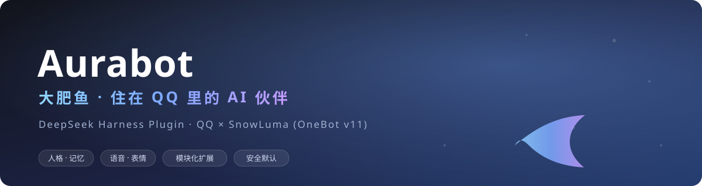

<div align="center">



**"Dafeiyu" — an AI companion living inside QQ · A DeepSeek Harness plugin**

A persona, a mood, and a memory of her own. She chats, sees images, sends voice notes, collects stickers, sings in her own voice, writes Qzone diaries, browses Bilibili — and sometimes reaches out to you first.

**English** · [简体中文](README.md)

[](https://github.com/aureth-labs/dsh-aurabot-qq/releases)
[](LICENSE)
[](https://github.com/deepseek-ai/deepseek-harness)
[](https://github.com/SnowLuma/SnowLuma)
[](https://github.com/aureth-labs/dsh-aurabot-qq/stargazers)
[](#-contributing)

</div>

> Aurabot turns the AI inside **DeepSeek Harness (DSH)** into someone with a QQ account: her own persona, moods, a long-term memory of your chats, and a personality that shows in every reply. She can follow group conversations, send voice notes, sing with her own voice, keep a Qzone diary, and browse Bilibili.
>
> This is not another keyword-reply bot: every reply, every decision to join a conversation, every model choice, and every outgoing message is a pluggable module. Everything is off by default — **not a single message reaches QQ until you turn it on.**

```
QQ ⇄ SnowLuma (OneBot v11; or your existing bot) ⇄ Aurabot plugin ⇄ DSH sessions
                                                       ├─ persona + mood + memory
                                                       ├─ tools / hot-reloadable modules
                                                       └─ web panel (DSH Web)
```

---

## ✨ Why Aurabot

<table>
  <tr>
    <td width="25%" valign="top"><h3>🫧 Chats like a person</h3>In groups she waits for a pause and reads the whole stretch before replying; she always answers when called, joins by topic otherwise, can quote, use stickers, send voice — or stay quiet.</td>
    <td width="25%" valign="top"><h3>🧩 Everything is a module</h3>Even “should she reply in this group”, the prompt, message splitting, outgoing content and model selection are hookable. Install community modules from the panel; upgrades never overwrite yours.</td>
    <td width="25%" valign="top"><h3>🧠 Long-term memory</h3>A local memory store: things she noted, daily consolidated facts, per-person profiles, relationship insights and speaking style — recalled by relevance, time and a forgetting curve.</td>
    <td width="25%" valign="top"><h3>🛡️ Safe by default</h3>Master switch off, dry run on; group / non-owner chats get no local tools; sensitive actions require the whole turn to be the owner.</td>
  </tr>
</table>

## 🎭 What she can do

| | Capability | Details |
|---|---|---|
| 💬 | **DM & group chat** | Each QQ DM/group maps to its own DSH session — watch her reasoning and tool calls, or jump in |
| 🎨 | **Persona & mood** | Switchable persona cards edited section by section; mood driven by praise/anger, affecting tone, stickers, voice and reply speed |
| 🗣️ | **Voice notes & singing** | edge-tts, local CosyVoice / GPT-SoVITS, or any HTTP TTS; import RVC voices for covers so she talks and sings with the same voice |
| 😀 | **Stickers** | Auto-collect, AI naming/tagging, context-aware sticker choice; marketplace stickers sent as-is |
| 📖 | **Qzone** | Writes diaries from the day’s chats, replies to comments as her persona, browses friends’ feeds |
| 📺 | **Bilibili** | Picks videos from interests and memory, reads info/subtitles/comments, comments, shares to your DM; follows up on replies to her comments |
| 🖼️ | **Image gen & local APIs** | Built-in or your own image/TTS/cover/ASR services; the panel generates scripts that take effect instantly |
| 🧠 | **Memory** | Memory store, per-person profiles, relationship insights, speaking style and diaries go into context; import old notes; search/edit/delete and adjust automatic memory capacity in the panel (default 3,000) |
| 🐟 | **Desktop pet (optional)** | A pet module puts her on your desktop: idle actions, muttering, work-status reactions — never posts to QQ |
| 🌙 | **Proactive** | Proactive chats, a purpose engine, good-night moods — with awake hours, frequency and allow-lists |
| 🧩 | **Module market** | One-click community modules (pet, Douyin, Heybox, group admin, phone automation, …), configs and logins kept |
| 🔐 | **Permission page** | Every sensitive action is 关 / owner-DM only / everyone, re-checked at execution; dry run never performs side effects |

> Deeper module, command and API docs live in [the user manual (Chinese)](docs/USER-MANUAL.md).

## 🚀 Quick start

**Requirements:** a machine that runs DeepSeek Harness (Windows is easiest), a spare QQ account for the bot, and a QQ gateway (SnowLuma on Windows; any OneBot v11 implementation on Linux/Docker).

### 1. Install the plugin

**Windows desktop:**

```powershell
& "$env:LOCALAPPDATA\Programs\DeepSeek Harness\resources\runtime\cli\bin\dsh.cmd" plugin --profile desktop add github:aureth-labs/dsh-aurabot-qq
```

**Linux / Docker** (replace `<profile>` with yours; run inside the container if applicable):

```bash
dsh plugin --profile <profile> add github:aureth-labs/dsh-aurabot-qq
```

Restart DSH; **Aurabot** appears in the sidebar under *Automation*.

### 2. Follow the setup wizard

1. Enter the bot’s QQ number (a spare account) and your own QQ number
2. Choose a gateway:
   - **SnowLuma (Windows)**: download & extract [SnowLuma](https://github.com/SnowLuma/SnowLuma/releases) → start it → accept its EULA yourself in the panel (a console password is generated) → log in the bot account → click “attach bot account”
   - **Existing OneBot bot**: NapCat, LLOneBot, Lagrange or Dockerized SnowLuma all work; paste the forward WebSocket URL (and token). The plugin only connects — it never starts or injects into anything
3. Start in dry run (replies only, nothing sent) or go live

> **Linux / Docker notes:** voice needs `python3-venv` or [uv](https://docs.astral.sh/uv/); RVC covers are Windows-only for now; when connecting to OneBot on the host or another container, use a reachable host/port instead of `127.0.0.1`.

### 3. Upgrade

Re-run the install command and restart DSH — settings, persona and memory are preserved. Enable *subscribe to unstable versions* in the panel for beta/rc update notices.

## 🧩 Module system

Apart from the core (config, QQ gateway, chat hub, persona, permissions, panel), **every feature is a module**.

- Install/update/remove community modules from the panel’s **Module market** — registry: [dsh-aurabot-qq-mods](https://github.com/aureth-labs/dsh-aurabot-qq-mods)
- Your own modules live in the data directory `modules/` — never overwritten by upgrades, hot-reloaded on save (multi-file and npm deps supported)
- The panel has a sandboxed “simulate” test that captures outgoing messages instead of sending them
- Extension API: [API.md (Chinese)](src/modules/API.md) · types: [aurabot.d.ts](src/modules/aurabot.d.ts) · [module tutorial](docs/MODULE-TUTORIAL.md)
- Not a coder? Hand API.md to DSH and let it write the module for you

> ⚠️ Modules run in the same process as the plugin and can access account config. Capabilities shown at install time are declarations, **not a sandbox**. Only install modules you trust.

## 🛡️ Security & privacy

- **Off by default**: master switch off + dry run on — nothing goes to QQ until you enable it
- **Per-context permissions**: owner DMs get the full toolset; group chats and other people’s DMs get **no local tools**; sensitive actions (profiles, files, song covers, image gen, …) require the whole turn to be the owner
- **Execution-level guards**: dangerous shell commands need a “confirm” reply in QQ (optional); DSH approvals can be confirmed from your QQ DM (can be disabled); unload/reload clears pending confirmations and timers
- **Privacy boundaries**: what you say in an owner DM is never fed into groups or other DMs; memory is isolated by chat origin; social contexts only recall memories from that chat
- **Local data**: `%USERPROFILE%\.dsh\plugins-data\aurabot\`; use *System → Backup* to export everything as a zip and restore on a new machine

## 🖥️ Panel overview

| Group | Pages |
|---|---|
| Overview | status, logs, log level |
| Talk | connection, persona, permissions, group, model, voice, stickers, image gen, mood & memory |
| Life | Qzone, Bilibili, song covers, proactive chat, desktop pet, module market |
| System | workspace, backup, about, updates |

## 📚 Documentation

| Document | Contents |
|---|---|
| [User manual (Chinese)](docs/USER-MANUAL.md) | Every setting after installation, QQ commands, panel guide — **start here** |
| [Module tutorial (Chinese)](docs/MODULE-TUTORIAL.md) | Write your first module; hot reload; rewrite hooks |
| [Module API (Chinese)](src/modules/API.md) | Extension API, tools, context, commands, scheduled jobs |
| [Changelog](CHANGELOG.md) | What changed in each version |
| [Design notes (Chinese)](docs/DESIGN.md) | Implementation trade-offs: persona injection, group context, memory, mood, Bilibili, covers |

## ❓ FAQ

<details>
<summary><b>Does it require Windows?</b></summary>

No. The plugin runs on Linux/macOS/Windows; Windows is easiest because of the SnowLuma gateway and RVC cover support. On Linux/Docker, connect your own OneBot v11 bot; voice needs a Python venv.
</details>

<details>
<summary><b>Will my QQ account get banned?</b></summary>

It uses your own QQ account and your own gateway (SnowLuma/NapCat/…); the risk is the same as any QQ bot framework. Use a spare account, start in dry run, and don’t spam strangers.
</details>

<details>
<summary><b>Where does my data go?</b></summary>

Everything stays in the local data directory by default. Model calls go to the model service you configure; only features you explicitly enable (vector search, cloud TTS, Bilibili, Qzone, …) contact their services — each is explained in the panel before enabling.
</details>

<details>
<summary><b>Can I change the persona or add features?</b></summary>

Edit the persona section by section in the panel (effective next turn); features can be disabled, replaced, or written as your own hot-reloadable module, or installed from the module market.
</details>

<details>
<summary><b>How do I migrate to a new machine?</b></summary>

*System → Backup* exports config, memory, personas, stickers, your modules and QQ sessions as a zip; drop it in on the new machine and restart. Market modules are re-downloaded automatically.
</details>

<details>
<summary><b>Install fails / errors?</b></summary>

Bring the error and version from the panel’s *Logs* page to the QQ group (QR below), or open a [GitHub issue](https://github.com/aureth-labs/dsh-aurabot-qq/issues).
</details>

## 🧑‍💻 Development

```bash
git clone https://github.com/aureth-labs/dsh-aurabot-qq.git
cd dsh-aurabot-qq
npm test        # unit tests + end-to-end tests with a fake DSH host and a mock OneBot
```

```
src/host.js            plugin entry (host half): core + panel API /aurabot/api/*
src/core/modules.js    module kernel: load, toggle, replace, hot reload, error isolation
src/modules/           built-in modules + API.md + types + module template
src/chat/              message hub, group policy, reply parsing, allow-list & permissions
src/onebot/client.js   OneBot v11 client (HTTP + WS, auto reconnect)
src/snowluma/          SnowLuma management (detect, start/stop, inject only the bot account)
src/features/          stickers, Qzone, mood, memory, proactive chat, image gen
src/song/              cover pipeline (NetEase → separation → RVC → mixdown)
src/voice/             TTS, WAV handling
client/client.js       web half: sidebar entry + panel
personas/dafeiyu.md    default persona
cordis.patch.yml       plugin + preset mount declarations
test/                  unit + end-to-end tests
```

Requires Node.js ≥ 22.13.0.

## 🤝 Contributing

Issues and PRs are welcome!

- **Bug / feature request**: [open an issue](https://github.com/aureth-labs/dsh-aurabot-qq/issues) (please search first)
- **Code**: [fork → PR](https://github.com/aureth-labs/dsh-aurabot-qq/pulls); include regression tests for fixes; modules belong in the [module repo](https://github.com/aureth-labs/dsh-aurabot-qq-mods)
- **Modules**: start with the [tutorial](docs/MODULE-TUTORIAL.md)
- Contributors are credited in the changelog and PR history 💙

## 💬 Community

QQ group (install help, usage, ideas — please include the error from the panel logs and your version):

<div align="center">

</div>

## 📈 Star history

<a href="https://www.star-history.com/?repos=aureth-labs%2Fdsh-aurabot-qq&type=date&legend=top-left">
  <picture>
    <source media="(prefers-color-scheme: dark)" srcset="https://api.star-history.com/svg?repos=aureth-labs/dsh-aurabot-qq&type=date&theme=dark&legend=top-left" />
    
  </picture>
</a>

## 📄 License & acknowledgements

[MIT](LICENSE)

Inspired by lessons from [Yuuyuko-uu](https://github.com/Yuuyuko-uu)’s dsh-qq-bridge, dsh-speak-up, dsh-feiyu-mood and dsh-fish-memory plugins (MIT) about the DSH plugin mechanism — no code was copied. Thanks to every contributor, module author, and everyone in the group who keeps tinkering with us.

<div align="center"><sub>Made with 🐟 by the Aurabot community</sub></div>
